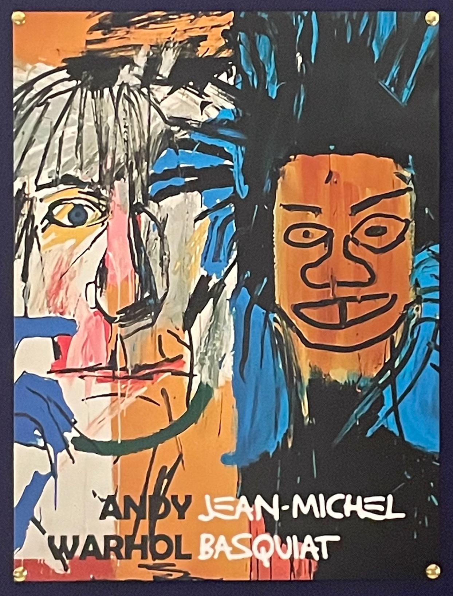

희랍어 시간에서 읽은 구절인데,
아름다운 것과 어려운 것은 구별되지 않은 개념이었다고 합니다.

그러고 보면 쉬운 것이 아름답다고 느껴진 적이 있었던가요.

---

어느 때인지 모르겠지만,
어느 순간부터 내 삶의 기준을 도덕이 아닌 아름다움을 기준으로 삼은 적이 있습니다.

지금 두 선택이 있을 때, 어떤 선택이 더 추한가. 더 아름다운가.
논리나 시덥잖은 도덕을 빼놓고선, 그냥 직감적으로 무엇이 더 아름다운가.

아름다움이라고 하면 되게 거창한 것 같지만,
생각보다 간단하고 직관적일 수도 있습니다.

구린 유튜브를 보면서 멍하니 보고 있는 내 모습과,
좋은 영화를 집중해서 보고 있는 내 모습 중 무엇이 더 아름다운지.

아이들을 차별하는 어른과
아이들을 각자 방식대로 사랑해주는 어른 중 무엇이 더 아름다운지.

나무를 무자비하게 썰어대는 사람과 
나무를 심는 사람 중 무엇이 더 아름다운지.

<figure>
  
</figure>

---

요즘 찾기 어려운 것들이 있습니다.
다정한 것.
진심인 것.
겸손한 것.
느린 것.
정성을 들이는 것.
청빈한 것.

점점 더 인간성이 옅어지는 시대가 다가오는 것 같은데,
인간만이 가지는 것 중에 아름다운 것을 더 가꿔나가는 것이,
인간성을 지키는 몇 안되는 방법일 수도 있을 것 같습니다.

어려운 것은 아름다운 것.
어려움에 굴복하지 않고 아름다운 것을 잘 가꿔나갈 수 있으면 좋겠습니다.